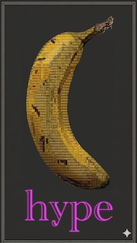

# hype

A terminal text art generator that renders images as colored text.



<video src="https://github.com/user-attachments/assets/20e1d190-d08c-40be-9753-c83d0ff128f8" autoplay loop muted playsinline></video>

## Install

### Homebrew

```bash
brew install ackertyson/hype/hype
```

This installs a prebuilt binary (macOS and Linux, arm64 and x86_64) with no dependencies.

Prebuilt binaries are also attached to each [GitHub release](https://github.com/ackertyson/hype/releases).

### From source

Install [Rust](https://rust-lang.org/tools/install), then:

```bash
cargo install --locked --path .
```

PNG and JPEG are built in. GIF, WebP and BMP are opt-in to keep the binary small:

```bash
cargo install --locked --path . --features gif,webp,bmp
```

SVG output (`--svg`) is opt-in too, as it carries the Recursive font's glyph outlines, upright and italic (about 450 KB):

```bash
cargo install --locked --path . --features svg
```

## Usage

Run `hype help`. The help includes an exact output contract for scripts and agents; when its output is captured rather than shown on a terminal, it is plain text.

## Features

### Rendering modes

- **Block** — The default and highest-fidelity mode. Each character cell is sampled as 2×4 subpixels and drawn with whichever half-block or quadrant glyph (`▀▄▌▐▘▝▖▗▚▞`…) and pair of colors best fits it, giving crisp edges and legible text in logos.
- **Braille** — Maps each cell to a Unicode braille pattern (U+2800–U+28FF) for a dot-matrix look, in one color per cell. A dot is lit when it is brighter than the threshold and better represented by the cell's color than by the dark background, so dark details stay sharp inside bright areas.
- **ASCII** — Printable ASCII only, for any terminal or font. Flat areas use a density ramp; along edges, characters are chosen by shape (measured from real monospace fonts) so outlines and lettering stay readable.

### Color modes

- **Truecolor (24-bit)** — Full RGB color via ANSI escape sequences. Auto-detected from the `COLORTERM` environment variable.
- **256-color** — Maps colors to the ANSI 256-color palette (6x6x6 color cube + grayscale ramp) using perceptually-weighted nearest-match. Block mode fits cell shapes against the palette colors actually displayed. Used as the fallback when truecolor is not detected.
- **Grayscale** — Renders using only grayscale values.

### Dithering (256-color block mode)

- **Floyd-Steinberg** — Error-diffusion dithering for smooth gradients.
- **Ordered (Bayer 4x4)** — Patterned dithering for a stylized, halftone-like look.

### Other capabilities

- **SVG output** — With `--svg`, ASCII (including `--text`) and braille are drawn as vector art instead of text: sharp at any size, for screens or print. Glyphs are from the [Recursive](https://github.com/arrowtype/recursive) font, and glyph choice uses coverage measured from its own outlines, at five weights: from regular strokes for light tones to the heaviest for the darkest, in even steps of ink, for a much wider tonal range with smooth gradients. With `--text`, `_underscored_` words (Project Gutenberg's italics markup) are drawn in Recursive's true cursive italics; in the terminal the underscores are simply dropped. `--svg fill` (the default) enlarges glyphs to fill their cells for a wider tonal range; `--svg natural` keeps the font's proportions. Add `--light` for ink on white paper. Convert to PNG with any SVG renderer, e.g. `resvg art.svg art.png -w 3840`.
- **Light backgrounds** — Braille and ASCII assume a dark terminal. With `--light` they draw for a light one instead (a light theme, or paper): areas close to the background are left blank, the rest is drawn in the image's own colors, and thin ASCII glyphs get darker ink to match heavy ones.
- **Alpha compositing** — Transparent regions can be composited against a configurable background color (black, white, or any RGB value). Without a background, transparency is preserved as the terminal's own background.
- **Auto-sizing** — Output dimensions default to the terminal width with aspect ratio preserved. Width and height can also be set explicitly.
- **Input image format support** — PNG and JPEG by default; GIF, WebP, and BMP via cargo features.

## License

MIT (`LICENSE`). The Recursive glyph data in `src/recursive.rs`, compiled in only with the `svg` feature, is © The Recursive Project Authors under the SIL Open Font License 1.1 (`LICENSE-Recursive.txt`).

## Acknowledgements

This project was written by Claude with human supervision. The first working version only took 1 hour!
